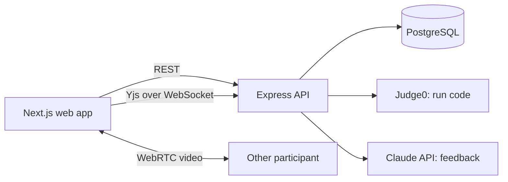

# MockMate

A real-time mock interview platform. An interviewer and a candidate share one room with a live code editor, a video call, code execution, a scorecard and AI-generated feedback.

## Features
- Email/password and **Google sign-in** (JWT, bcrypt), Zod validation, rate limiting
- **Role-based access:** the room creator is the interviewer; scorecard, AI feedback, question picker, timer control and replay are interviewer-only (enforced on the server)
- Collaborative Monaco editor synced in real time with Yjs (CRDT) over WebSocket; shared language selection
- Video call: peer-to-peer WebRTC (PeerJS) by default, **LiveKit** for group calls when configured
- **Question bank** (10 DSA problems) that loads starter code into the shared editor
- **Interview timer** and **room chat**, both shared through the Yjs document
- **Whiteboard** for system design (shared canvas)
- Run code in JavaScript, Python, C++ and Java (Judge0)
- Scorecard (PostgreSQL + Prisma) and AI feedback from the Claude API
- **Session replay:** play back how the code was written
- **Shareable report page** (public unguessable link, private notes excluded)
- **Custom questions:** interviewers write and save their own problems
- **Email invites** (Resend) and **local session recording** (screen + audio, saved on your device)
- Interview history dashboard
- Unit tests (Vitest), Dockerfiles, GitHub Actions CI

## Architecture


## Tech stack
Next.js 14 (JavaScript/JSX), Monaco, Yjs, PeerJS, Express (TypeScript), Prisma, PostgreSQL, Zod, Docker, GitHub Actions.

## Run locally
Requirements: Node 20+, pnpm, Docker. The quick way is one command: `pnpm setup` (starts Postgres, installs, generates Prisma, creates tables), then `pnpm dev`.

Manual steps:
```bash
docker compose up -d db                       # PostgreSQL
pnpm install
pnpm --filter server exec prisma generate
pnpm db:push                                  # create tables
pnpm dev                                      # web: :3000, API + WebSocket: :4000
```
1. Open http://localhost:3000, create an account, create a room.
2. Open the room link in a second browser (or a private window), register another user and join with the code.
3. Type in the editor, start the call, run code, fill the scorecard and click "AI feedback".

Optional settings in `apps/server/.env` (and `apps/web/.env.local`):
- `ANTHROPIC_API_KEY` enables AI feedback
- `GOOGLE_CLIENT_ID` (server) and `NEXT_PUBLIC_GOOGLE_CLIENT_ID` (web) enable Google sign-in. Create an OAuth client at console.cloud.google.com and add `http://localhost:3000` as an authorized JavaScript origin
- `RESEND_API_KEY` (and optionally `EMAIL_FROM`) enables email invites
- `LIVEKIT_API_KEY`, `LIVEKIT_API_SECRET` (server) and `NEXT_PUBLIC_LIVEKIT_URL` (web) switch the call to LiveKit (free cloud tier at livekit.io)

## Scripts
| Command | What it does |
|---|---|
| `pnpm dev` | Start web and API |
| `pnpm test` | Run unit tests |
| `pnpm typecheck` | Type-check both apps |

## Demo kit
See [docs/DEMO.md](docs/DEMO.md) for the demo video script, resume bullets, a LinkedIn post and interview answers.

## Security notes
Change `JWT_SECRET` in `apps/server/.env` before deploying. Never commit `.env` files.

## Deploy
See [DEPLOY.md](DEPLOY.md).

## Roadmap
- [x] Auth, rooms, real-time editor, code execution, scorecard
- [x] Video call, AI feedback, dashboard
- [x] Tests, Docker, CI
- [x] Google login, LiveKit, chat, timer, whiteboard, question bank, replay, shareable reports, roles
- [x] Custom question editor, local recording, email invites
- [ ] Cloud recording storage, calendar integration
